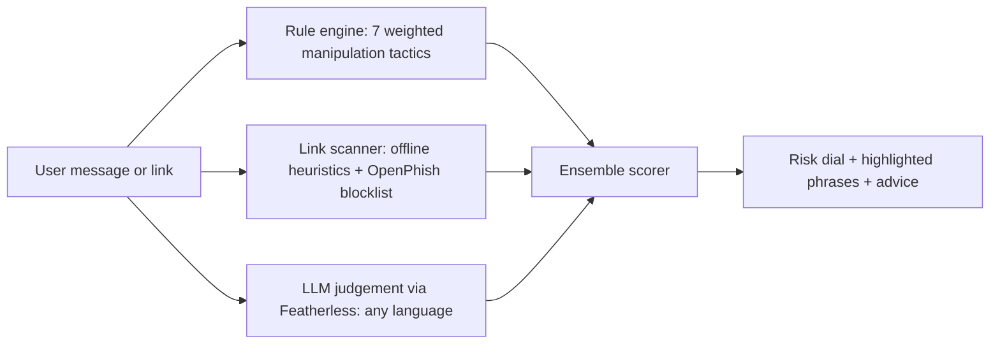

# ScamShield: AI scam checker for messages and links

**Track:** AI + Cybersecurity (ForgeHacks Online 2026)

Paste a suspicious SMS, WhatsApp or email text, or a link. ScamShield rates the risk, highlights the exact phrases that
look manipulative, and explains in plain language what to do. Built for people who get OTP, KYC, parcel and lottery scams daily.

## Problem and users
Scam messages cause real financial loss, and most people have nowhere to ask "is this real?" in the moment. Many scams arrive
in Hindi, Telugu and other local languages, where keyword filters fail. Target users: everyday phone users, elders, and the
families who help them.

## How it works

- **AI judgement:** an open-source LLM (Featherless, free for participants) rates scam probability, names the scam type and writes the explanation. It understands non-English messages.
- **Rules:** transparent regex tactics (urgency, fake authority, asks for OTP/PIN, threats, prizes, odd payments, click pressure).
- **Links:** brand look-alikes, risky TLDs, raw IPs, shorteners, punycode, `@` tricks, optional OpenPhish feed. Links are never opened.
- **Ensemble:** rules + links combine as a noisy-OR; AI is blended 55/45; strong deterministic evidence can't be overruled; blocklisted links force a high score.
- **Graceful fallback:** with no API key the app runs fully offline on rules + links.

## Shield Guide (onboarding)
A built-in guide teaches a first-time user in about 30 seconds: a 4-step spotlight tour of the real scanner, a labeled demo that runs through the real scan pipeline, fixed-answer questions (works offline, no extra AI calls), context-aware hints, and tap-friendly tooltips. Available in English, Hindi and Telugu.

## Run it (all free)
```
pip install -r requirements.txt
export FEATHERLESS_API_KEY=your_key        # optional, enables the AI layer
uvicorn main:app --reload
python -m pytest test_core.py
```
Deploy free on Render (`render.yaml` included). Env vars: `FEATHERLESS_API_KEY`, `LLM_MODEL`, `BLOCKLIST_FEED=1`, `RATE_LIMIT`.

## Privacy and limits
Nothing is stored. With an API key set, message text is sent to the LLM provider and the UI says so. This is a risk
assessment, not a guarantee. The AI can be wrong, so high-risk results should be verified through official channels.

## Impact
Gives people a free second opinion before they click, reply or share a code, in the language the scam arrived in.